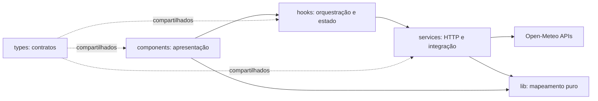
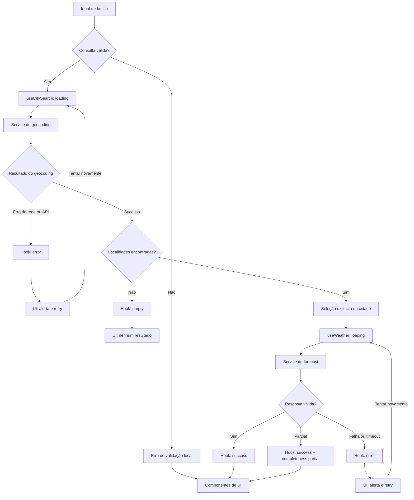

# Plano Técnico — Weather App

## Architecture

Aplicação SPA executada no navegador, sem backend próprio. O código de `src/` fica dividido em quatro camadas com dependências direcionadas: apresentação → hooks → services → APIs externas. Funções puras de `lib/` apoiam services e apresentação sem executar I/O; `types/` fornece contratos compartilhados.



- **`components/` — apresentação:** recebe dados/ações dos hooks e renderiza busca, resultados, clima, previsão e estados acessíveis. Não chama APIs, não controla cancelamento e não conhece nomes de campos Open-Meteo.
- **`hooks/` — orquestração e estado:** valida o ciclo de vida da busca/consulta, mantém estados da tela, solicita dados aos services, cancela chamadas obsoletas e expõe contratos prontos para a UI. Não contém parsing de payload nem JSX de apresentação.
- **`services/` — acesso a dados:** monta URLs e parâmetros, executa `fetch`, aplica timeout/cancelamento e converte falhas de transporte em erros tipados. Encaminha respostas para normalização e não decide como renderizá-las.
- **`lib/` — funções puras:** converte payloads em modelos do domínio, valida campos, alinha séries diárias, mapeia código WMO para rótulo pt-BR e converte/formata temperatura. Sem rede, estado React, DOM ou efeitos colaterais.
- **`types/` — contratos:** declara os tipos compartilhados entre as camadas; não contém lógica.
- **`main.tsx`/`App.tsx`:** inicialização e composição da tela, sem lógica de acesso a dados.

Dependências permitidas: components → hooks/lib/types; hooks → services/lib/types; services → lib/types. `lib/` e `types/` não dependem de React, services ou components. Isso mantém transformações testáveis sem navegador, integração testável com `fetch` mockado e apresentação testável com fixtures.

## Tech Stack

| Área | Decisão | Motivo / rastreabilidade |
| --- | --- | --- |
| Linguagem | TypeScript strict | Contratos explícitos para payload externo e modelos (FR-01 a FR-07). |
| UI | React + Vite | Segue a stack do repositório e atende à SPA web responsiva (FR-06). |
| Estilo | Tailwind CSS | Stack estabelecida; permite implementar os viewports definidos (AC-08, NFR-03). |
| Estado | React `useState` e hooks locais | Não há estado global, usuário autenticado nem dados compartilhados entre páginas. |
| Dados | `fetch` nativo com `AbortController` | Uma integração HTTP simples cobre as duas APIs, timeout e cancelamento (NFR-01, FR-07). |
| Testes | Vitest + Testing Library; Playwright | Unitários/componentes e fluxos E2E alinhados à stack existente e aos ACs. |
| Qualidade | Biome | Lint e formatação conforme configuração do repositório. |
| Pacotes | pnpm | Gerenciador definido pelo projeto. |

Não adicionar Redux, React Query, backend, banco de dados ou cache na primeira versão: o escopo é uma única tela, sem persistência e sem atualização automática.

## Project Structure

```text
src/
  components/
    CitySearch.tsx             # Entrada, resultados e seleção
    CurrentWeather.tsx         # Condições atuais e hora observada
    ForecastList.tsx           # Cinco dias e dias indisponíveis
    TemperatureUnitToggle.tsx  # Seletor Celsius/Fahrenheit
    QueryStatus.tsx            # Estados acessíveis de loading, vazio e erro
  hooks/
    useCitySearch.ts           # Busca, resultados e estado de geocoding
    useWeather.ts              # Consulta atual/diária e nova tentativa
  services/
    openMeteo.ts               # Transporte HTTP e contratos do provedor
  lib/
    mapOpenMeteo.ts            # Validação e normalização pura dos payloads
    weatherCode.ts             # Mapeamento de código WMO para rótulo pt-BR
    temperature.ts             # Conversão/formatação Celsius e Fahrenheit
  types/
    weather.ts                 # Contratos do domínio e estados de consulta
  App.tsx
  main.tsx
tests/
  unit/lib/                   # Mapeamento, validação, datas e conversões puras
  services/                   # URL, parâmetros, timeout e erros com fetch mockado
  hooks/                      # Estados, retry e cancelamento com serviços controlados
  components/                 # Renderização e interação acessível com Testing Library
  e2e/                        # Fluxos Playwright com rotas Open-Meteo interceptadas
```

Cada camada tem uma fronteira de teste: `lib/` usa testes unitários puros sem mocks; `services/` testa contrato HTTP com `fetch` mockado; `hooks/` testa transições de estado sem rede real; `components/` testa semântica e interação com dados de fixture; E2E valida o fluxo completo com APIs interceptadas. Não criar camada de repositório nem abstração genérica para apenas um provedor.

## Data Model

Os modelos internos usam unidades canônicas: temperatura em Celsius, vento em km/h, precipitação em mm e probabilidade em porcentagem. A conversão para Fahrenheit ocorre na apresentação sem alterar o dado base (FR-05, AC-07).

```ts
type Unit = 'celsius' | 'fahrenheit';
type QueryStatus = 'idle' | 'loading' | 'success' | 'error' | 'empty';
type DataCompleteness = 'complete' | 'partial';

interface City {
  id: number; // ID geográfico retornado pelo geocoding.
  name: string; // Nome da cidade retornado pelo geocoding.
  latitude: number; // Latitude usada na consulta meteorológica.
  longitude: number; // Longitude usada na consulta meteorológica.
  timezone?: string; // Fuso IANA, quando retornado pelo geocoding.
  region?: string; // Região administrativa (admin1), se disponível.
  country?: string; // Nome do país, se disponível.
  countryCode?: string; // Código ISO do país, se disponível.
}

interface CurrentWeather {
  observedAt: string; // `current.time`, no fuso local retornado pelo provedor.
  temperatureC: number; // `temperature_2m`, normalizada para Celsius.
  weatherCode: number; // `weather_code`, código meteorológico WMO.
  apparentTemperatureC?: number; // `apparent_temperature`, em Celsius.
  relativeHumidityPct?: number; // `relative_humidity_2m`, em porcentagem.
  windSpeedKmh?: number; // `wind_speed_10m`, normalizada para km/h.
  precipitationMm?: number; // `precipitation`, em milímetros.
  pressureHpa?: number; // `surface_pressure`, em hectopascais.
}

type ForecastDay =
  | {
      status: 'available'; // Dados essenciais do dia foram recebidos.
      dateLocal: string; // `daily.time`, data local no formato YYYY-MM-DD.
      weatherCode: number; // `daily.weather_code`, código WMO.
      temperatureMinC: number; // `temperature_2m_min`, em Celsius.
      temperatureMaxC: number; // `temperature_2m_max`, em Celsius.
      precipitationProbabilityMaxPct?: number; // `precipitation_probability_max`, em porcentagem.
    }
  | {
      status: 'unavailable'; // O dia existe, mas faltam dados essenciais.
      dateLocal: string; // Data local esperada no formato YYYY-MM-DD.
    };

interface WeatherData {
  city: City; // Localidade selecionada pela pessoa.
  timezone: string; // Fuso IANA devolvido pela API Forecast.
  current: CurrentWeather; // Condições atuais; temperatura e código são essenciais.
  forecast: ForecastDay[]; // Cinco dias, de hoje até hoje + 4.
  completeness: DataCompleteness; // Indica se campos opcionais ou dias estão indisponíveis.
  retrievedAt: string; // Instante ISO em que a resposta foi recebida no cliente.
}

interface QueryError {
  kind: 'network' | 'timeout' | 'http' | 'invalid-response'; // Classe para tratamento e testes.
  message: string; // Mensagem segura para apresentação ou diagnóstico.
}
```

`City.id` preserva o ID numérico do geocoding. `ForecastDay.dateLocal` é uma data de calendário `YYYY-MM-DD`, não um instante UTC. `Unit` determina apenas a formatação das temperaturas; os modelos mantêm Celsius como unidade canônica. Payloads brutos do provedor não devem ser usados diretamente pela UI.

## Data Flow

1. A pessoa envia a busca. A UI remove espaços nas extremidades e valida pelo menos dois caracteres; entradas inválidas não geram chamadas (AC-01).
2. `useCitySearch` marca `loading` e chama o serviço de geocoding. O serviço limita a cinco resultados e preserva a ordem de relevância recebida.
3. O serviço normaliza os resultados em `City`. Zero resultados produzem estado `empty`; falha HTTP/rede produz estado `error` sem apagar a consulta (AC-02, AC-12).
4. A pessoa seleciona explicitamente um resultado. Nenhum clima é consultado antes da seleção (FR-02, AC-03).
5. `useWeather` solicita clima atual e cinco dias para as coordenadas selecionadas. `timezone=auto` faz o provedor resolver o fuso local pelas coordenadas; o fuso retornado é guardado e aplicado às datas (AC-03, AC-05).
6. O serviço valida campos essenciais, converte datas/condições e normaliza unidades para `WeatherData`. Campos opcionais ausentes são omitidos; dias sem campos essenciais tornam-se `unavailable`.
7. Os componentes renderizam os dados. O seletor mantém `Unit` em estado local e formata todas as temperaturas; os valores do modelo continuam em Celsius (AC-06, AC-07).
8. Ao iniciar outra seleção, solicitações anteriores são canceladas. Respostas que não correspondam à seleção mais recente são ignoradas.



## External APIs

### Geocoding

- **URL:** `GET https://geocoding-api.open-meteo.com/v1/search`
- **Parâmetros:** `name=<consulta trimada>` (obrigatório), `count=5`, `language=pt`, `format=json`.
- **Uso:** chamar apenas após validar dois ou mais caracteres; codificar query params com `URLSearchParams` e preservar caracteres Unicode.
- **Resposta resumida:**

```json
{
  "results": [
    {
      "id": 2950159,
      "name": "Berlin",
      "latitude": 52.52,
      "longitude": 13.419,
      "timezone": "Europe/Berlin",
      "country": "Germany",
      "country_code": "DE",
      "admin1": "Berlin"
    }
  ]
}
```

- **Mapeamento para `City`:** `id` → `id`; `name` → `name`; `latitude`/`longitude` mantêm os nomes; `timezone` → `timezone`; `admin1` → `region`; `country` → `country`; `country_code` → `countryCode`. `results` ausente ou vazio é uma busca sem resultados (`empty`), não falha.

### Forecast

- **URL:** `GET https://api.open-meteo.com/v1/forecast`
- **Parâmetros:** `latitude=<City.latitude>`, `longitude=<City.longitude>`, `timezone=auto`, `forecast_days=5`, `temperature_unit=celsius`, `wind_speed_unit=kmh`, `precipitation_unit=mm`.
- **`current`:** `temperature_2m,relative_humidity_2m,apparent_temperature,weather_code,wind_speed_10m,precipitation,surface_pressure`.
- **`daily`:** `weather_code,temperature_2m_max,temperature_2m_min,precipitation_probability_max`.
- **Resposta resumida:**

```json
{
  "timezone": "America/Sao_Paulo",
  "current": {
    "time": "2026-10-27T09:00",
    "temperature_2m": 20.0,
    "relative_humidity_2m": 60,
    "apparent_temperature": 19.0,
    "weather_code": 0,
    "wind_speed_10m": 12.0,
    "precipitation": 0.1,
    "surface_pressure": 1013.0
  },
  "daily": {
    "time": ["2026-10-27", "2026-10-28", "2026-10-29", "2026-10-30", "2026-10-31"],
    "weather_code": [0, 1, 2, 3, 45],
    "temperature_2m_min": [15.0, 16.0, 17.0, 14.0, 13.0],
    "temperature_2m_max": [24.0, 25.0, 26.0, 22.0, 21.0],
    "precipitation_probability_max": [0, 10, 20, 35, 40]
  }
}
```

- **Mapeamento para `WeatherData`:** o `City` selecionado é preservado; `timezone` → `WeatherData.timezone`; `current.time` → `CurrentWeather.observedAt`; `temperature_2m` → `temperatureC`; `weather_code` → `weatherCode`; `apparent_temperature` → `apparentTemperatureC`; `relative_humidity_2m` → `relativeHumidityPct`; `wind_speed_10m` → `windSpeedKmh`; `precipitation` → `precipitationMm`; `surface_pressure` → `pressureHpa`. Os arrays `daily` são unidos por índice: `time[i]` → `dateLocal`, `weather_code[i]` → `weatherCode`, `temperature_2m_min[i]`/`temperature_2m_max[i]` → mín./máx. em Celsius e `precipitation_probability_max[i]` → `precipitationProbabilityMaxPct`. O código WMO também alimenta o rótulo pt-BR por uma função de domínio; `retrievedAt` é gerado pelo cliente ao receber a resposta.
- **Validação:** exigir timezone, temperatura e código atuais; para cada uma das cinco datas esperadas, exigir data, código e mín./máx. Se faltarem campos opcionais, omiti-los; se faltarem campos essenciais de um dia, criar `ForecastDay` indisponível para essa data. Normalizar apenas após verificar que os arrays diários têm índices correspondentes.

Ambas as APIs são acessadas por HTTPS, sem API key. Não implementar fallback para outro provedor. Antes da distribuição, confirmar termos, atribuição, limites e cobertura exigidos pela especificação.

## State Management

- **Localização:** sem store global. `useCitySearch` mantém a consulta, resultados e erro de geocoding; `useWeather` mantém localidade selecionada, dados meteorológicos e erro da consulta. Ambos vivem na tela principal e expõem ações/estado aos componentes.
- **Busca:** `idle` antes da primeira busca; `loading` durante a chamada; `success` com resultados; `empty` quando a API responde com zero resultados; `error` para falha local, de rede, HTTP ou payload inválido.
- **Clima:** `idle` antes da seleção; `loading` durante Forecast; `success` quando current essencial é válido, mesmo se houver dados parciais; `error` quando a solicitação falha ou current essencial está ausente. `empty` é reservado à busca sem resultados.
- **Parcialidade:** `WeatherData.completeness` é `partial` quando campos opcionais faltam ou algum dia é indisponível. Isso mantém o status de ciclo de vida em `success` e permite exibir o aviso de dados incompletos da spec. `ForecastDay.status` identifica quais dias estão disponíveis.
- **Unidade:** `App` mantém `unit: Unit` em estado local iniciado em `celsius`; passa unidade e ação de alternância aos componentes. Ao renderizar, uma função pura de `lib/temperature.ts` deriva o número e o rótulo a partir dos valores canônicos em Celsius. Alternar a unidade só provoca re-render; não altera `WeatherData`, parâmetros da API ou estado de requisição, portanto não gera novo request.
- **Concorrência:** ao selecionar outra cidade ou substituir uma busca, `AbortController` cancela o request anterior e um identificador de request ignora respostas obsoletas. Ao iniciar consulta para outra cidade, limpar o dado exibido como atual.
- **Persistência:** não persistir cidade, buscas, unidade ou dados meteorológicos em localStorage/sessionStorage, cookies ou servidor (NFR-05).

## Error Handling

| Condição | Estado/contrato | Comportamento |
| --- | --- | --- |
| Campo vazio ou menos de 2 caracteres | Validação local; busca fica `idle` | Mensagem do AC-01; nenhuma chamada externa. |
| Geocoding retorna zero resultados | Busca `empty`, `results: []` | Mensagem do AC-02; consulta mantida; nenhuma chamada Forecast. |
| Rede indisponível ou erro HTTP em geocoding | Busca `error`; `QueryError.kind` = `network` ou `http` | Mensagem do AC-12; manter consulta e permitir retry manual. HTTP 429 usa a mesma mensagem, sem retry automático. |
| Rede indisponível ou erro HTTP em Forecast | Clima `error`; `QueryError.kind` = `network` ou `http` | Mensagem do AC-09; botão de retry; não mostrar dados da cidade anterior como atuais. |
| Timeout após 8 s | `error`; `QueryError.kind` = `timeout` | Encerrar indicador de loading, exibir AC-09 e permitir retry manual. Cancelamento por troca de cidade não é reportado como erro. |
| JSON inválido, arrays desalinhados ou fuso ausente | `error`; `QueryError.kind` = `invalid-response` | Tratar como resposta inválida; não renderizar payload parcial como clima atual válido; usar AC-09. |
| Campos opcionais atuais ausentes | Clima `success`; `WeatherData.completeness` = `partial` | Omitir campos sem valor substituto e anunciar aviso de dados incompletos (AC-10). |
| Campo essencial atual ausente | Clima `error`; `QueryError.kind` = `invalid-response` | Não renderizar cartão como válido; mensagem do AC-09. |
| Campo opcional diário ausente | Clima `success`; `completeness` = `partial` | Omitir somente esse campo naquele dia (AC-10). |
| Data, código, mínima ou máxima diária ausente | Clima `success`; dia `unavailable` e `completeness` = `partial` | Mostrar “Previsão indisponível” nesse dia e manter os outros dias válidos (AC-10). |
| Resposta de solicitação obsoleta | Ignorada | Não altera seleção nem conteúdo atual; cancelamento não gera alerta. |

Retries são sempre iniciados pela pessoa e repetem a última busca válida ou consulta da cidade selecionada. Não realizar retries automáticos. Erros técnicos detalhados ficam fora das mensagens da interface; mensagens visíveis seguem AC-09 e AC-12.

## Testing Strategy

- **Vitest — `lib/` (unitários puros):** testar conversão e arredondamento nos valores de AC-07, garantir que a conversão não muta Celsius canônico, mapear códigos WMO, normalizar campos opcionais/essenciais e produzir exatamente cinco datas no fuso local. Cobrir limites e entradas inválidas sem DOM, rede ou mocks.
- **Vitest — `services/` (integração HTTP isolada):** mockar `fetch` e verificar URL/parâmetros das duas APIs, codificação de caracteres Unicode, limite de cinco resultados e mapeamento do payload. Cobrir lista vazia, HTTP 429/5xx, falha de rede, JSON inválido, arrays diários desalinhados, timeout em 8 s e cancelamento. Não chamar Open-Meteo real.
- **Vitest + Testing Library — hooks/componentes:** fornecer services controlados e renderizar os estados `idle`, `loading`, `success`, `empty` e `error`; verificar dados parciais no estado `success`, com `completeness = 'partial'`. Cobrir mensagens/roles `status` e `alert`, seleção explícita, retry manual, navegação por teclado e que alternar unidade não chama novamente o service.
- **Playwright — E2E:** interceptar geocoding e forecast, sem depender de rede externa. Cobrir fluxo busca → seleção → clima atual/previsão → Fahrenheit/Celsius; busca vazia e sem resultados; falha de geocoding; timeout/erro de forecast e retry; resposta parcial; troca rápida de cidade com resposta antiga atrasada.
- **Playwright — viewport e navegadores:** executar o fluxo principal em 320 × 640 e 1280 × 800 CSS px; afirmar ausência de rolagem horizontal e controles cortados. Rodar Chromium, Firefox e WebKit na matriz prevista em NFR-03 e validar teclado, foco visível e anúncios acessíveis nos fluxos principais.
- **Desempenho:** medir busca p95 ≤ 2 s e consulta p95 ≤ 4 s sob o perfil de rede de referência do NFR-01; testar timeout de 8 s com resposta controlada. Manter esses testes separados dos E2E funcionais para evitar flakiness; nenhum teste automatizado depende da disponibilidade real do provedor.

## Risks & Trade-offs

| Decisão adotada | Alternativa considerada | Trade-off e motivo |
| --- | --- | --- |
| SPA responsiva sem backend; chamadas diretas para Open-Meteo | Backend/proxy próprio | Menos infraestrutura e sem credencial para proteger; aumenta dependência de disponibilidade, CORS e limites do provedor. Um proxy só se justifica se surgir requisito de segredo, cache, analytics ou controle central de tráfego. |
| Hooks e estado React local | Redux ou React Query | Adequado a uma única tela e sem persistência/cache; bibliotecas externas facilitariam cache, deduplicação e políticas de retry, mas acrescentariam conceitos e dependências desnecessárias agora. |
| `fetch` nativo | Axios ou cliente HTTP dedicado | Menos dependências e suficiente para duas APIs; exige padronizar manualmente timeout, cancelamento e erros. Se a integração crescer, reavaliar um cliente dedicado. |
| Sem cache e sem persistência local | Cache em memória/localStorage ou suporte offline | Evita exibir dados antigos e respeita o escopo/NFR-05; perde disponibilidade offline e pode repetir chamadas durante a visita. Cache só deve ser adicionado com política explícita de validade. |
| Celsius como unidade canônica; conversão na renderização | Solicitar Celsius ou Fahrenheit ao provedor em cada alternância | Mantém um único payload e evita novo request ao trocar unidade; conversão/arredondamento ficam sob responsabilidade da aplicação e devem ser testados contra AC-07. |
| Um request Forecast para `current` e `daily` | Requests separados para atual e previsão | Uma chamada reduz latência e coordenação; requests separados permitiriam estados/atualizações independentes, mas duplicariam tráfego e complexidade sem requisito atual. |
| `timezone=auto` baseado nas coordenadas | Enviar timezone IANA da resposta de geocoding explicitamente | Evita depender de um valor de timezone no resultado de busca; exige validar o timezone devolvido pelo Forecast e testar mudanças de data/fuso. |
| Aplicação web responsiva | Apps nativos iOS/Android | Atende ao escopo com uma base e matriz web; nativo poderia integrar melhor recursos do dispositivo, mas aumenta custo, distribuição e manutenção e está fora do escopo atual. |